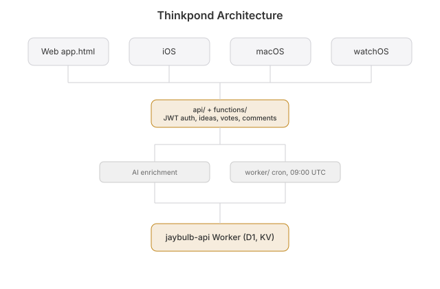

 [](https://github.com/nulljosh/thinkpond/actions/workflows/test.yml) 

Drop an idea in. Watch it ripple.

A feed of ideas that people post, vote on and argue about. Every morning a new one shows up on its own, with a build spec and a plan already written.

**[thinkpond.jaybulb.com →](https://thinkpond.jaybulb.com)**

## Features

- A feed of ideas, sorted by New or Trending and filtered by tag or category
- Post your own idea. Sign in to post, vote and comment
- Upvote or downvote. The good ideas rise
- Comment threads on every idea, and a Markdown export of each one
- A new AI idea every morning at 09:00 UTC. A judge throws out the generic ones before they post
- A build spec and a step-by-step plan for every idea, written on Cloudflare Workers AI
- App Store matches in each brief: the closest apps already out there
- Idea Bases: clusters of ideas around one topic
- iPhone, Mac and Apple Watch apps, with Face ID or Touch ID on iPhone
- Dark and light themes
- $1 one-time Pro unlock on the web for unlimited posts and a 24-hour pin

## Development

```bash
npm install
npm run dev        # build, then serve dist/ with wrangler
npm test           # vitest
npm run deploy     # build, then deploy dist/ to the sparkjar Pages project
npx wrangler deploy --config worker/wrangler.jsonc   # the daily cron Worker
```

The Pages project still has the old name, `sparkjar`. The native apps are generated with `xcodegen generate` from each platform folder.

## Docs

- [Whitepaper](WHITEPAPER.md): how an idea is written, judged and planned
- [API](docs/API.md): every route, and the WebMCP tools
- [Architecture](docs/ARCHITECTURE.md): what each folder does
- [Roadmap](roadmap.md)
- [Contributing](CONTRIBUTING.md) and [Security](SECURITY.md)



## License

MIT 2026 Joshua Trommel. See [LICENSE](LICENSE).
